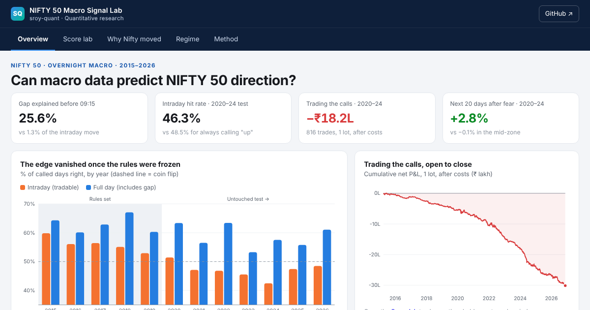
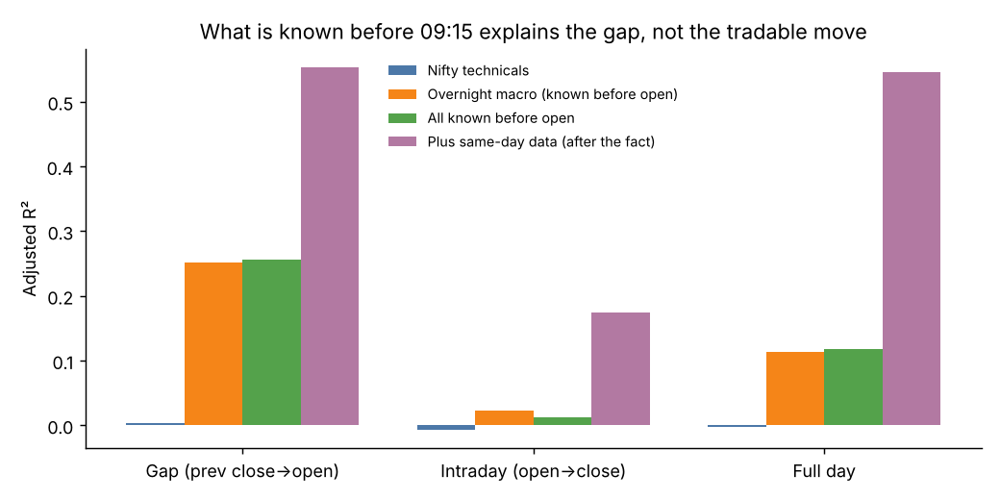
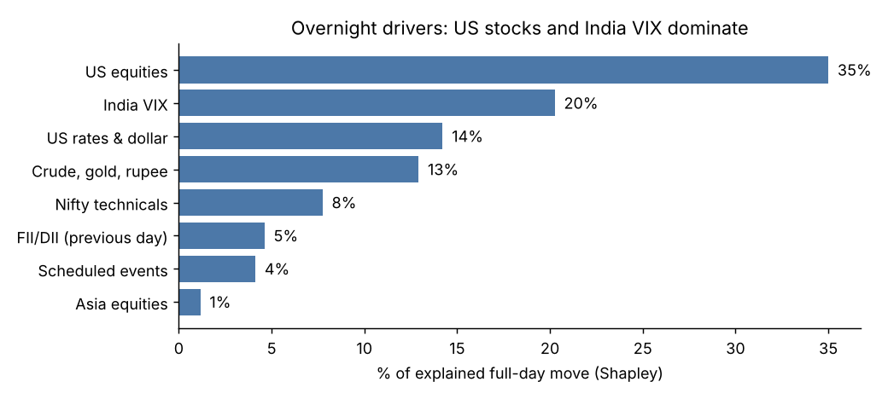
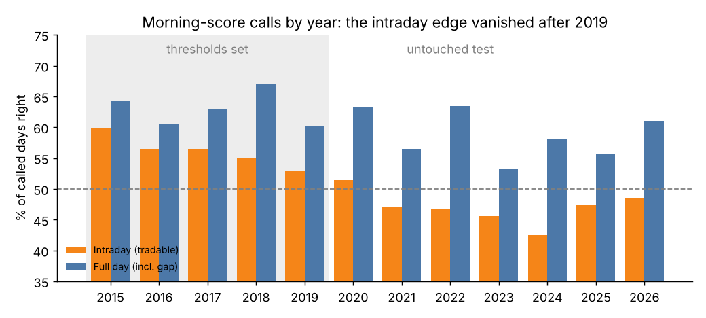
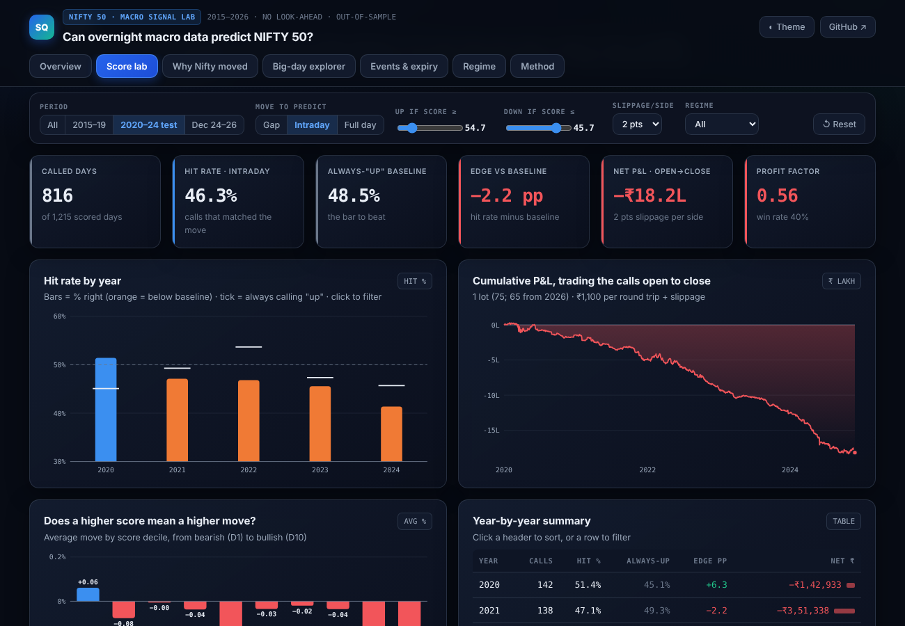
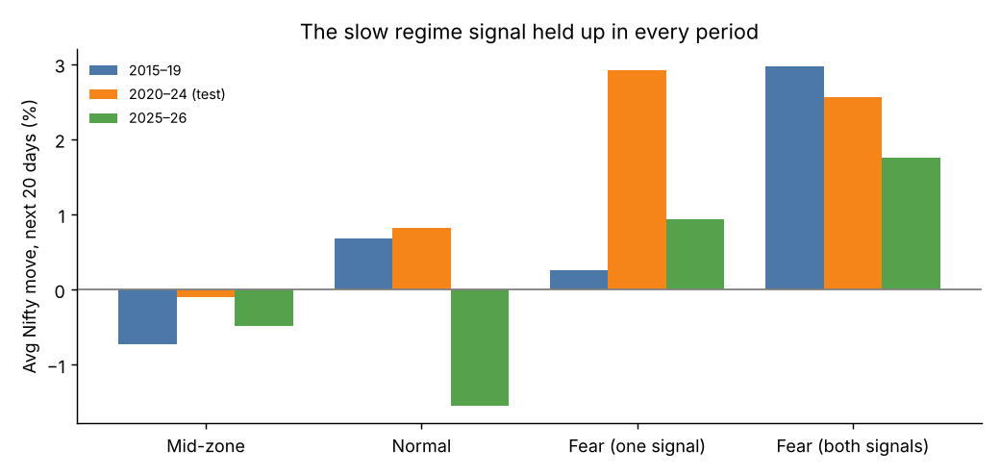

# Can macro data predict NIFTY 50 direction? An honest test

Social media is full of "99% accurate" Nifty predictors built on the S&P 500, US yields, crude, the dollar, FII flows and India VIX. I tested the idea properly: explain every session first, then build a fixed morning score, then test it on data it had never seen, after real trading costs.

### Key findings
- **Gap, yes:** data known before 09:15 explains about **26%** of the opening gap.
- **Tradable move, no:** in the untouched 2020–24 test the open-to-close calls were right **46%** of the time, and lost money in every year after costs.
- **Regime, yes:** "fear" regimes were followed by stronger 20-day returns, and the "mid-zone" was weak, in every period.
- **Size, yes; sign, no:** a 3-input model known at 09:00 separates calm days from wide ones in every period, and gap size alone tells you whether a gap is likely to fill by 11:00.

**[▶ Open the interactive dashboard](https://sroy-quant.github.io/nifty-macro-research/)** to change thresholds, costs, periods and regimes, and every figure recalculates from the daily data.

**Contents:** [Part 1: attribution](#part-1-why-does-nifty-move-each-day-dec-2024--nov-2026-487-sessions) · [Part 2: morning score](#part-2-a-fixed-morning-score-tested-out-of-sample-2015--2026) · [Regime](#what-held-up-the-regime) · [Range & gap fill](#follow-up-day-range-and-gap-fill) · [Lessons](#lessons) · [Methodology](#methodology--stack)

## Part 1: why does Nifty move each day? (Dec 2024 – Nov 2026, 487 sessions)

For every session I collected 25+ drivers and tagged each one by **when it is known**:
- **PRE**: known before 09:15 IST (US close, US VIX, yields, dollar index, Brent, India VIX, previous day's FII/DII, Nifty technicals, scheduled events);
- **SAME**: known only during or after the session (same-day FII/DII, VIX change).

All overseas data is joined with `merge_asof(..., allow_exact_matches=False)`, so a session only ever sees bars dated strictly before it. Every day also has a news reason built from same-day market headlines.

- PRE drivers explain about **25% of the gap** but only about **1–2% of the intraday move**.
- Same-day FII flows and the VIX change explain much more, but they are only known after the close.
- About 80% of big days (|move| ≥ 1%) had a clear news cause, led by geopolitics, crude and tariffs/trade, mostly unscheduled.

## Part 2: a fixed morning score, tested out of sample (2015 – 2026)

Score = equal-weight mean of five signed z-scores: US VIX change, S&P 500 return, US 10Y change, dollar index return, Brent return. Weights and signs were fixed in advance; UP/DOWN thresholds were set on **2015–2019 only**, then frozen.

| Move | 2015–19 (set) | 2020–24 (untouched test) | Up days, 2020–24 |
|---|---|---|---|
| Gap | 64% | 68% | 68% up |
| **Intraday (tradable)** | 56% | **46%** | 49% |
| Full day | 63% | 59% | 56% |

The <b>Score lab</b> in the dashboard lets you move the thresholds and see that no setting rescues the intraday calls out of sample:

- The full-day "edge" comes from the gap, which is already priced at the open.
- Trading the calls open-to-close lost money in **every** test year after costs (₹1,100 + 2 points per side per lot). Fading them made money before costs but not after.
- A "monthly expiry days fall" pattern seen in 2025–26 (71% down) was 47–49% in 2015–2024: a small-sample artifact.

## What held up: the regime

- **Fear** (India VIX in its top 20%, or Nifty ≥ 8% below its 52-week high) was followed by above-average 20-day returns.
- **Mid-zone** (2–8% below the high with calm VIX) was weak in all three periods: a useful "don't add longs" filter.

## Follow-up: day range and gap fill

Direction is close to a coin flip, but **how far** Nifty moves is not. A three-input model known at 09:00 (the previous day's range, the 5-day average range and India VIX) sorts days into Quiet, Normal and Wide. It was fitted on 2015–19 and its cut-offs were never changed.

| Expected | Avg range 2015–19 / 2020–24 / Dec 24 → | Days moving > 1% |
|---|---|---|
| Quiet | 0.75 / 0.79 / 0.76% | 16 / 20 / 17% |
| Normal | 1.02 / 1.00 / 1.06% | 40 / 41 / 46% |
| Wide | 1.29 / 1.56 / 1.21% | 62 / 68 / 59% |

- **Gap fill by 11:00** depends on gap size. The share of gaps that filled:

  | Gap size | Filled by 11:00 |
  |---|---|
  | 0.2–0.4% | 51% |
  | 0.4–0.7% | 30% |
  | 0.7–1.0% | 16% |
  | above 1.0% | 7% |

  Direction, a "surprise" gap and the regime added nothing reliable beyond size.
- **Versus India VIX:** on days when the model expects more range than VIX implies, the actual range ran 1.09–1.15× the VIX-implied move, against 0.94–1.02× when it expects less. This held in every period and in 30 of 40 rolling windows. The effect is modest.
- **Versus a naive baseline** ("same as yesterday's range"): the model picks the exact bucket no better than the baseline (≈50%). Where it beats the baseline is in separating calm days from big ones: Wide − Quiet spread of 0.45% vs 0.28% since Dec 2024, and half as many surprise big days on "Quiet" calls.
- **Tested and dropped:**
  - updating the range at 09:15 or 09:30;
  - trading predicted trend days;
  - an ML filter on an overnight strategy;
  - a hidden-Markov regime.

  None beat the simpler versions on unseen data.

## Lessons
1. Split every driver by **when it is known**; most "predictive" macro links are same-day explanations.
2. Fix weights and thresholds before testing, keep an untouched period, and compare with a shuffled benchmark.
3. Report results **after costs**, by year, including what failed.
4. Daily direction is close to a coin flip; slower regimes carry the usable information.
5. Size is easier than sign: range and gap fill are predictable when direction is not.

## Methodology & stack
- **Data:** Yahoo Finance daily bars (NIFTY 50, S&P 500, VIX, US 10Y, dollar index, Brent, USD/INR, Asia), NSE FII/DII, India VIX, and an event calendar (RBI, Fed, budget, elections, expiries, holidays), Jan 2015 – Nov 2026.
- **No look-ahead:** overseas bars are joined with an as-of join that only allows bars dated strictly before the session; z-scores use a trailing 252-day window.
- **Validation:** rules fixed on 2015–19, tested once on 2020–24, then tracked live; compared with base rates, by year and against a shuffled benchmark.
- **Costs:** 1 lot, ₹1,100 per round trip plus 2 points slippage per side (5-point stress test).
- **Production:** a daily pipeline on GitHub Actions scores each morning before the open and grades the call after the close.
- **Stack:** Python (pandas, NumPy, statsmodels, matplotlib), GitHub Actions, GitHub Pages, and a dependency-free HTML/SVG dashboard.

The source code is private. I'm happy to walk through the method or share details on request.

*Research and education only, not investment advice.*

© 2026 sroy-quant · Write-up, charts and dashboard licensed under [CC BY 4.0](LICENSE).
